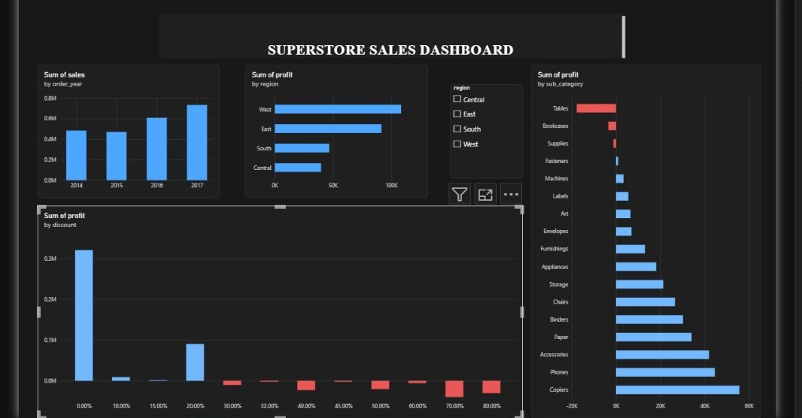

# Sales Analysis ETL Pipeline

### From raw sales data to business insights — with Python, SQL, Airflow and Power BI

**Sales growth does not always mean profit growth.**

A business can sell more, offer bigger discounts, and still lose money on the products customers are buying.

This project builds an end-to-end data pipeline using the Sample Superstore dataset to investigate a practical business question:

**Where is the business making money, where is it losing money, and what role do discounts play in profitability?**

I built a pipeline that transforms raw sales records into structured, quality-checked data, automates the workflow with Apache Airflow, and presents the findings through an interactive Power BI dashboard.

The goal was not just to analyze sales, but to build a repeatable process that turns raw data into information a business can use.

---

## The Business Problem

Sales teams often focus on revenue, but revenue alone does not tell the whole story.

A product may generate high sales while contributing very little profit. Aggressive discounting may increase order volume while quietly reducing profitability. Regional performance may also differ significantly.

Without a reliable data pipeline and clear reporting, these patterns can be difficult to identify.

This project explores four business questions:

- How has sales performance changed over time?
- Which regions contribute the most and least profit?
- Which product categories and sub-categories are profitable or loss-making?
- At what discount levels does profitability begin to deteriorate?

The analysis focuses on identifying patterns in the data rather than assuming that higher sales automatically indicate better business performance.

---

## Project Overview

I developed a complete ETL workflow that takes raw Superstore sales data through extraction, transformation, loading, SQL validation, and reporting.

The pipeline:

1. Extracts the raw sales dataset.
2. Cleans and transforms the data using Python and pandas.
3. Loads the processed data into a SQLite database.
4. Runs SQL data quality checks.
5. Creates a business-ready `sales_clean` table.
6. Automates the workflow using Apache Airflow.
7. Connects the cleaned data to Power BI for business analysis.

The pipeline can also be executed independently of Airflow using a single Python command.

---

## Key Business Findings

The analysis revealed several important patterns in the dataset.

### 1. Sales recovered after a dip in 2015

Sales declined slightly in 2015 before increasing in the following years.

| Year | Sales |
|---|---:|
| 2014 | ~$484K |
| 2015 | ~$471K |
| 2016 | ~$609K |
| 2017 | ~$733K |

The dataset shows a strong upward sales trend from 2015 to 2017.

### 2. Profitability varies significantly by region

The West generated the highest profit, while the Central region generated the lowest.

| Region | Sales | Profit |
|---|---:|---:|
| West | ~$725K | ~$108K |
| East | ~$679K | ~$92K |
| Central | ~$501K | ~$40K |
| South | ~$392K | ~$47K |

The Central region retained approximately **8% of its sales as profit**, making it an important area for further investigation.

### 3. High sales do not always translate into high profit

Some product sub-categories generated substantial sales but struggled with profitability.

- **Tables** recorded approximately $17.7K in losses.
- **Bookcases** lost approximately $3.5K.
- **Supplies** lost approximately $1.2K.
- **Machines** generated approximately $189K in sales but only around $3.4K in profit.
- **Copiers** generated the highest profit among the sub-categories, at approximately $55.6K.

These findings demonstrate why analyzing profit alongside sales is essential.

### 4. Deep discounts were associated with losses

The discount analysis revealed a clear pattern:

- Products sold with discounts between 0% and 20% generated approximately $421K in total profit.
- Discount levels of 30% and above were associated with losses in the dataset.
- Approximately 1,393 items sold at these higher discount levels recorded a combined loss of about $135K.

Tables were particularly affected. While Tables sold without a discount generated approximately $13.3K in profit, those sold at discounts of 30% or more recorded approximately $31K in losses.

**Business takeaway:** The findings suggest that discounting deserves closer attention, particularly for loss-making products. Discounts should be evaluated against profitability, not sales volume alone.

---

## Power BI Dashboard

The Power BI dashboard turns the analysis into a visual summary of business performance.



The dashboard includes:

- **Sales by Year** — tracks sales performance from 2014 to 2017.
- **Profit by Region** — compares regional profitability.
- **Profit by Sub-Category** — highlights profitable and loss-making products.
- **Profit by Discount Level** — shows how profit changes across discount levels.
- **Region Slicer** — allows users to filter the visuals by region.

The dashboard was built using the processed dataset:

`data/processed/superstore_clean.csv`

Power BI file:

`powerbi/superstore_dashboard.pbix`

---

## Data Pipeline Architecture

The project follows a structured ETL workflow:

**Extract → Transform → Load → Validate → Analyze**

### Extract

Reads the raw Sample Superstore CSV containing 9,994 records and 21 original columns.

### Transform

Uses Python and pandas to:

- Clean and standardize the data.
- Handle date fields.
- Preserve postal codes in the correct format.
- Create `Order Year`, `Order Month`, and `Shipping Days`.

### Load

Saves the transformed dataset as a clean CSV and loads it into SQLite.

The database contains a `sales` table for the processed records.

### Validate and Clean with SQL

Seven SQL data quality checks validate the loaded data.

All seven checks passed with **zero bad rows**.

The SQL workflow then creates a `sales_clean` table containing additional business features:

- `discount_pct`
- `profit_margin`
- `discount_band`

These features support the profitability and discount analysis.

---

## Automation with Apache Airflow

To make the workflow repeatable, I created an Apache Airflow DAG named:

`sales_etl_pipeline`

The DAG contains four sequential tasks:

| Task | Responsibility |
|---|---|
| `extract_data` | Extracts the raw dataset |
| `transform_data` | Cleans and transforms the records |
| `load_data` | Loads the processed data |
| `clean_data` | Runs SQL quality checks and creates the clean table |

The DAG runs daily using the `@daily` schedule.

I configured Airflow to run locally through **WSL2 and Ubuntu**, since my development environment is Windows.

Each task passes its output to the next task through temporary files, keeping the workflow organized and allowing the pipeline functions to run independently.

A complete DAG run finished successfully in approximately **27 seconds** in my local environment.

Because this is a local setup, scheduled runs depend on Airflow being running on my computer.

---

## Technology Stack

| Tool | Purpose |
|---|---|
| Python | ETL logic and data processing |
| pandas | Data cleaning and transformation |
| SQLite | Local relational database |
| SQL | Data quality checks and business analysis |
| Apache Airflow | Workflow orchestration |
| Power BI | Interactive business dashboard |
| Jupyter Notebook | Data exploration and analysis |
| Git & GitHub | Version control and project documentation |
| WSL2 / Ubuntu | Local Airflow environment |

---

## Project Structure

```text
Sales-Analysis-ETL-Pipeline/
├── data/
│   ├── raw/
│   └── processed/
├── notebooks/
│   ├── 01_extract_and_explore.ipynb
│   └── 02_sql_analysis.ipynb
├── src/
│   └── etl.py
├── sql/
│   ├── 01_data_quality_checks.sql
│   └── 02_create_sales_clean.sql
├── dags/
│   └── sales_etl_dag.py
├── powerbi/
│   ├── superstore_dashboard.pbix
│   └── dashboard.jpeg
└── tests/
```

---

## How to Run the Pipeline

### Run without Airflow

Clone the repository:

```bash
git clone https://github.com/marywarimi/Sales-Analysis-ETL-Pipeline.git
cd Sales-Analysis-ETL-Pipeline
```

Create and activate a virtual environment:

```powershell
python -m venv .venv
.venv\Scripts\Activate.ps1
```

Install the required packages:

```bash
pip install pandas jupyter
```

Run the ETL pipeline:

```bash
python src/etl.py
```

The pipeline rebuilds the processed CSV and SQLite database locally.

### Run with Airflow

Airflow is configured to run through WSL2 Ubuntu.

The DAG is located at:

`dags/sales_etl_dag.py`

After starting the local Airflow instance, the pipeline can be triggered through the Airflow web interface.

---

## What I Learned

This project strengthened my understanding of how data engineering and business analysis work together.

I gained practical experience in:

- Designing a repeatable ETL workflow.
- Cleaning and transforming real-world structured data.
- Loading data into a relational database.
- Writing SQL validation and transformation queries.
- Building business-focused features.
- Orchestrating tasks with Apache Airflow.
- Connecting analytical data to Power BI.
- Translating data patterns into business questions.

More importantly, I learned that a data pipeline is not just about moving data from one place to another. It is about making data reliable, accessible, and useful for decision-making.

---

## Future Improvements

- [ ] Add automated tests using pytest.
- [ ] Improve pipeline logging and error handling.
- [ ] Add pipeline monitoring and failure notifications.
- [ ] Explore deployment beyond the local environment.

---

## About

**Mary Warimi**  

GitHub: [marywarimi](https://github.com/marywarimi)
